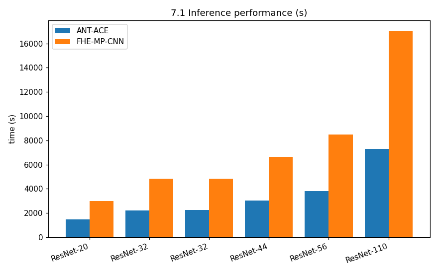
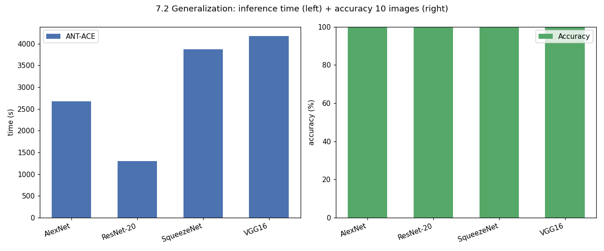
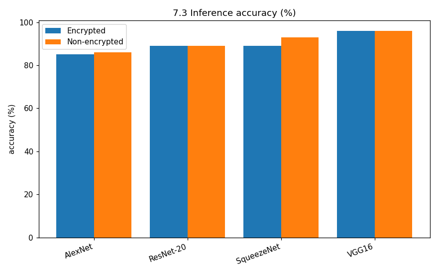

# Testing Report (auto-generated)

## 7.1 推理性能(CPU)

|编号|模型|集|ANT-ACE|FHE-MP-CNN|加速比|
|---|---|---|---|---|---|
|1|ResNet-20|CIFAR-10|1476.2(s)|2997.94(s)|2.030849478|
|2|ResNet-32|CIFAR-10|2213.3(s)|4851.45(s)|2.191953192|
|3|ResNet-32|CIFAR-100|2260.9(s)|4854.09(s)|2.146972445|
|4|ResNet-44|CIFAR-10|3022.2(s)|6657.36(s)|2.202819138|
|5|ResNet-56|CIFAR-10|3813.2(s)|8494.23(s)|2.227585755|
|6|ResNet-110|CIFAR-10|7317.0(s)|17056.50(s)|2.331078311|
|Average|-|-|-|-|2.188543053|

## 7.2 泛化能力

|编号|模型|集|ANT-ACE|准确率(10图)|
|---|---|---|---|---|
|1|AlexNet|CIFAR-10|2671.44(s)|100.00%|
|2|ResNet-20|CIFAR-10|1302.84(s)|100.00%|
|3|SqueezeNet|CIFAR-10|3870.14(s)|100.00%|
|4|VGG16|CIFAR-10|4177.17(s)|100.00%|

## 7.3 精度

|编号|模型|集|加密|非加密|差异|
|---|---|---|---|---|---|
|1|AlexNet|CIFAR-10|85.0%|86.0%|1%|
|2|ResNet-20|CIFAR-10|89.0%|89.0%|0%|
|3|SqueezeNet|CIFAR-10|89.0%|93.0%|4%|
|4|VGG16|CIFAR-10|96.0%|96.0%|0%|
|Average|-|-|-|-|1.25%|

## 7.4 GPU 性能

|编号|模型|集|FHE-MP-CNN|ANT-ACE|加速比|
|---|---|---|---|---|---|
|1|ResNet-20|CIFAR-10|15.1170(s)|8.4356(s)|1.792047987|
|2|ResNet-32|CIFAR-10|24.0020(s)|13.8008(s)|1.739174541|
|3|ResNet-32|CIFAR-100|21.7940(s)|13.8198(s)|1.577012692|
|4|ResNet-44|CIFAR-10|30.1020(s)|19.3284(s)|1.557397405|
|5|ResNet-56|CIFAR-10|38.4560(s)|24.6543(s)|1.559809039|
|6|ResNet-110|CIFAR-10|77.1290(s)|50.1480(s)|1.538027439|

## 7.5 运行时库单元测试

### CPU

| 测试用例 | 测试结果 |
|---|---|
| eg_fhertlib_add | PASS |
| eg_fhertlib_add_const | PASS |
| eg_fhertlib_bootstrap | PASS |
| eg_fhertlib_bootstrap_02 | PASS |
| eg_fhertlib_conv2d | PASS |
| eg_fhertlib_gemm | PASS |
| eg_fhertlib_gemm_02 | PASS |
| eg_fhertlib_mul_const | PASS |
| eg_fhertlib_mul_const_rtv | PASS |
| eg_fhertlib_relin | PASS |
| eg_fhertlib_relin_02 | PASS |

### GPU

| 测试用例 | 测试结果 |
|---|---|
| eg_rtphantom_add | PASS |
| eg_rtphantom_boot | PASS |
| relu | PASS |
| resnet20_cifar10_gpu | PASS |
| resnet32_cifar10_gpu | PASS |
| resnet32_cifar100_gpu | PASS |
| resnet44_cifar10_gpu | PASS |
| resnet56_cifar10_gpu | PASS |
| resnet110_cifar10_gpu | PASS |

