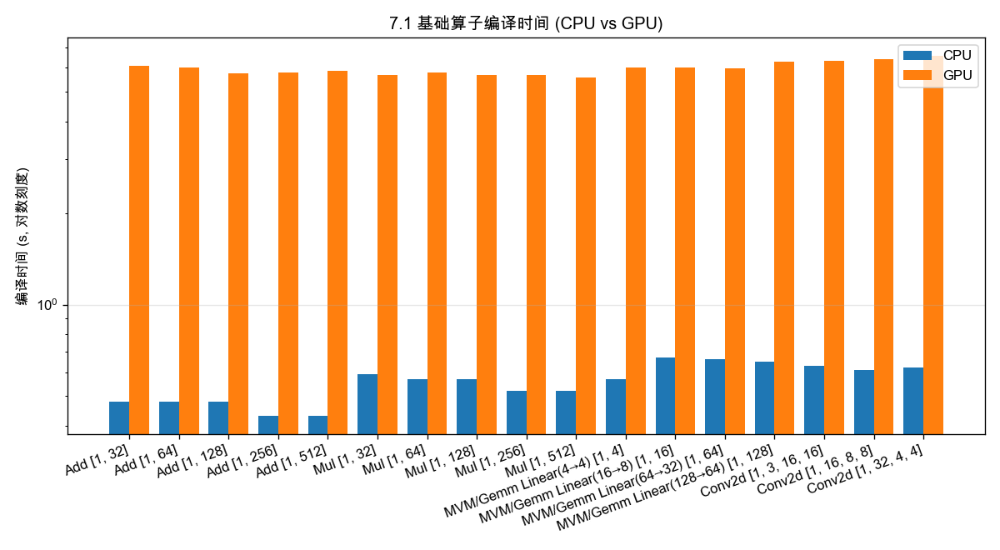
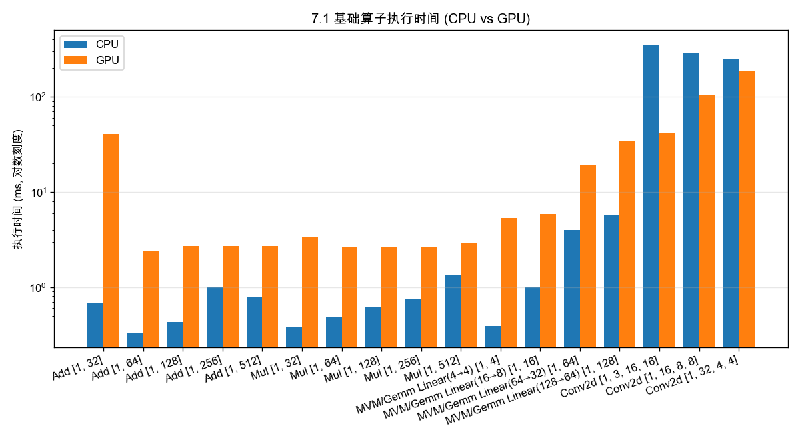
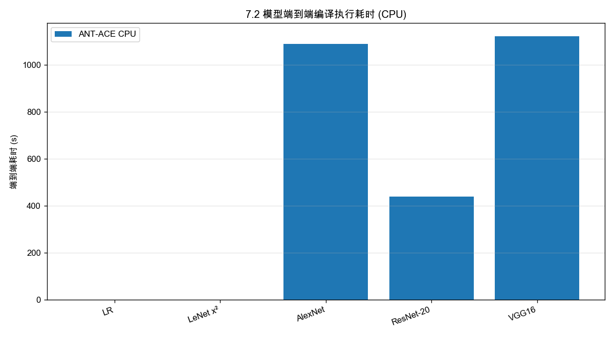
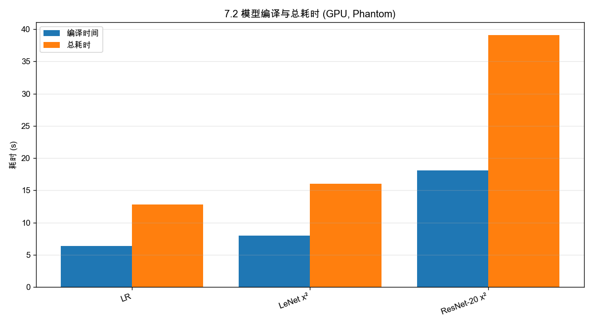
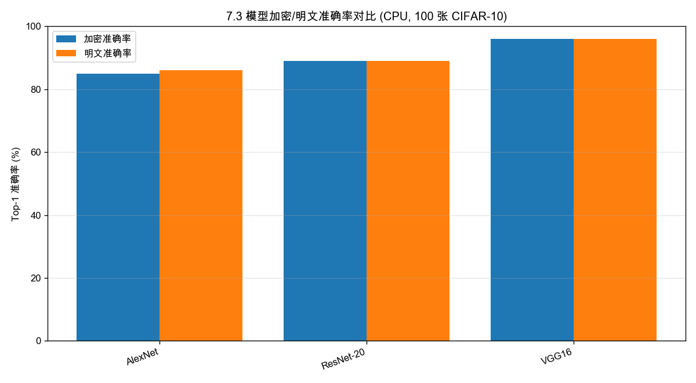
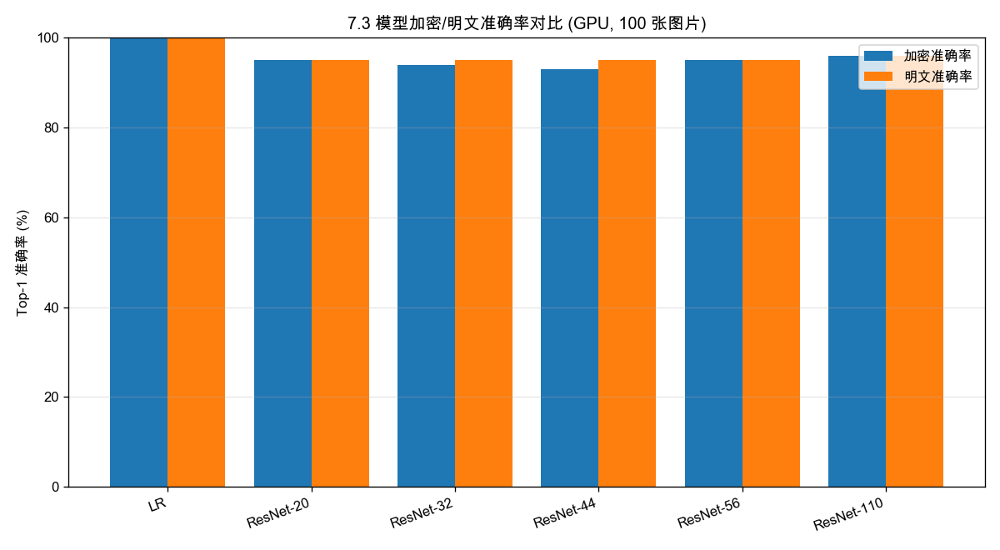
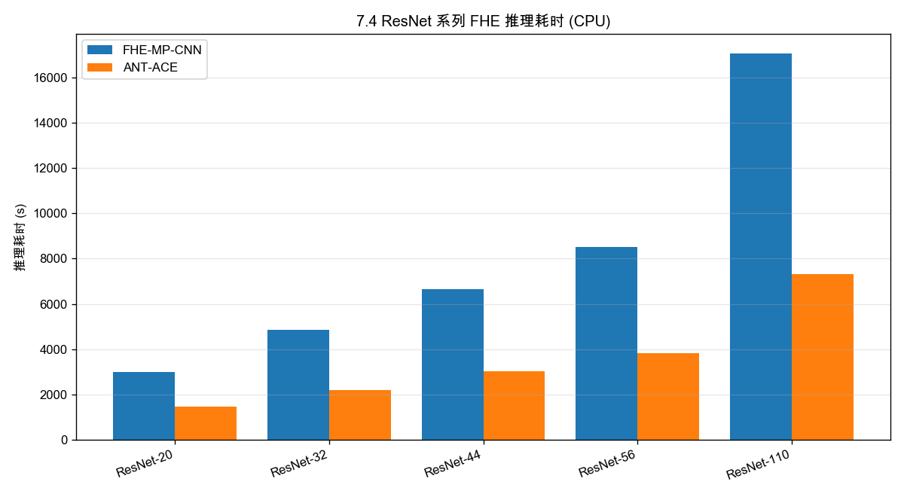
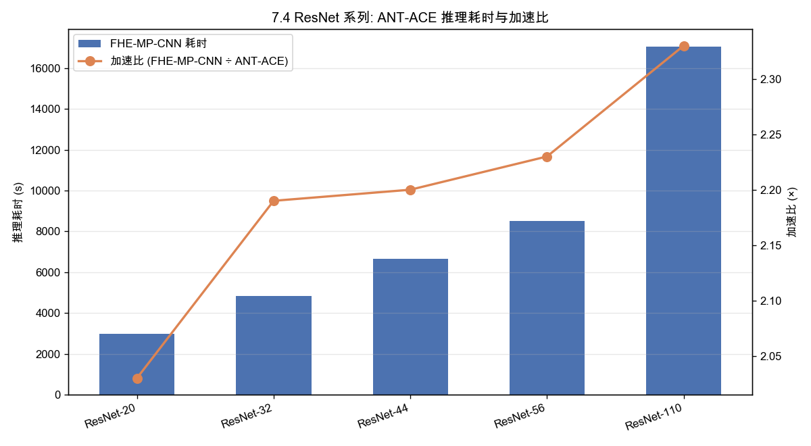
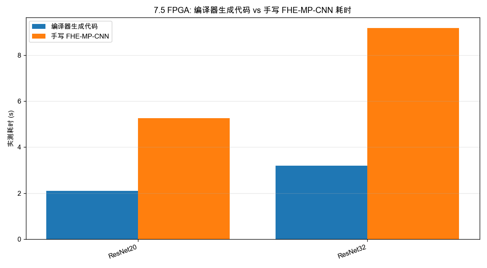
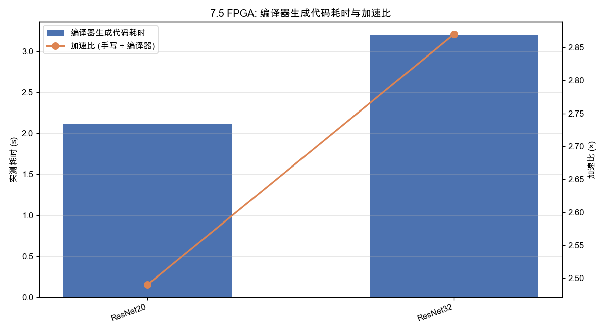

# Testing Report (auto-generated)

## 测试环境总览

本文档所有测试基于以下三套硬件 / 软件环境，各章节不再重复描述。

### CPU 环境

| 项 | 说明 |
|---|---|
| CPU | Intel Xeon Platinum 8369B @ 2.70GHz（Ice Lake，2P×32C×2T=128 vCPU），1T RAM，AVX-512 |
| OS | Ubuntu 24.04.1 LTS, Kernel 6.8.0-138-generic |
| FHE-Library | `ant`（library=ant，device=cpu） |
| 适用章节 | §7.1.1、§7.2.1、§7.3.1、§7.4 |

### FPGA / 硬件加速器环境

| 项 | 说明 |
|---|---|
| 硬件平台 | AMD Alveo V80 × 8、AMD Versal VPK180 × 2 |
| 适用章节 | §7.1.2、§7.2.2、§7.3.2、§7.5 |

### GPU 环境

| 项 | 说明 |
|---|---|
| CPU | Intel Xeon Platinum 8468V × 2 = 192 vCPU (48核96线程 × 2 Socket) |
| OS | Ubuntu 24.04.1 LTS, Kernel 6.8.0-138-generic |
| GPU | NVIDIA H20 96GB PCIe , CUDA 12.8 |
| FHE-Library | `Phantom`（library=phantom，device=cuda） |
| 适用章节 | §7.1.3、§7.2.3、§7.3.3 |

---

## 7.1 全同态加密编译器基础编译测试

本节给出 ACE 全同态加密编译器对基础算子的编译与执行测试数据，覆盖 **Add、Mul、MVM（矩阵-向量乘，对应 Gemm）和 Conv 四类。


#### 表 7.1 算子与输入形状配置

| 算子 | 形状变体数 | 具体输入形状 |
|---|---|---|
| Add | 5 | `[1, 32]`, `[1, 64]`, `[1, 128]`, `[1, 256]`, `[1, 512]`（双输入逐元素加法） |
| Mul | 5 | `[1, 32]`, `[1, 64]`, `[1, 128]`, `[1, 256]`, `[1, 512]`（双输入逐元素乘法） |
| MVM / Gemm | 4 | `Linear(4→4)`、`Linear(16→8)`、`Linear(64→32)`、`Linear(128→64)`，输入 `[1, d_in]` |
| Conv2d | 3 | `Conv2d(3→16, k=3)` → `[1, 3, 16, 16]`、`Conv2d(16→32, k=3)` → `[1, 16, 8, 8]`、`Conv2d(32→64, k=3)` → `[1, 32, 4, 4]` |

共 **17 项** 独立测试配置（5 + 5 + 4 + 3）。

### 7.1.1 CPU 测试数据

测试命令：

```bash
python3 benchmark/basic_ops/basic_ops.py --library ant --device cpu
```

#### 表 7.1-1 CPU 基础算子编译与执行结果

| 编号 | 算子 | 输入形状 | 编译时间 (s) | 执行时间 (ms) | 执行结果 |
|---|---|---|---:|---:|---|
| 1 | Add | `[1, 32]` | 0.48 | 0.68 | PASS |
| 2 | Add | `[1, 64]` | 0.48 | 0.33 | PASS |
| 3 | Add | `[1, 128]` | 0.48 | 0.43 | PASS |
| 4 | Add | `[1, 256]` | 0.43 | 0.99 | PASS |
| 5 | Add | `[1, 512]` | 0.43 | 0.79 | PASS |
| 6 | Mul | `[1, 32]` | 0.59 | 0.38 | PASS |
| 7 | Mul | `[1, 64]` | 0.57 | 0.48 | PASS |
| 8 | Mul | `[1, 128]` | 0.57 | 0.62 | PASS |
| 9 | Mul | `[1, 256]` | 0.52 | 0.74 | PASS |
| 10 | Mul | `[1, 512]` | 0.52 | 1.32 | PASS |
| 11 | MVM/Gemm | `Linear(4→4)` `[1, 4]` | 0.57 | 0.39 | PASS |
| 12 | MVM/Gemm | `Linear(16→8)` `[1, 16]` | 0.67 | 1.00 | PASS |
| 13 | MVM/Gemm | `Linear(64→32)` `[1, 64]` | 0.66 | 3.97 | PASS |
| 14 | MVM/Gemm | `Linear(128→64)` `[1, 128]` | 0.65 | 5.65 | PASS |
| 15 | Conv2d | `[1, 3, 16, 16]` | 0.63 | 354.51 | PASS |
| 16 | Conv2d | `[1, 16, 8, 8]` | 0.61 | 293.15 | PASS |
| 17 | Conv2d | `[1, 32, 4, 4]` | 0.62 | 251.39 | PASS |


原始日志保存位置：[`testing/7.1_cpu_ops.log`](7.1_cpu_ops.log)





### 7.1.2 FPGA 测试数据

> 待补充：在 FPGA 加速器上复测相同算子与形状组合，记录编译/执行时间与结果。

### 7.1.3 GPU 测试数据

测试命令：

```bash
python3 benchmark/basic_ops/basic_ops.py --library phantom --device cuda
```

#### 表 7.1-3 基础算子编译与执行结果（GPU）

| 编号 | 算子 | 输入形状 | 编译时间 (s) | 执行时间 (ms) | 执行结果 |
|---|---|---|---:|---:|---|
| 1 | Add | `[1, 32]` | 6.09 | 40.85 | PASS |
| 2 | Add | `[1, 64]` | 6.03 | 2.39 | PASS |
| 3 | Add | `[1, 128]` | 5.74 | 2.70 | PASS |
| 4 | Add | `[1, 256]` | 5.78 | 2.72 | PASS |
| 5 | Add | `[1, 512]` | 5.87 | 2.69 | PASS |
| 6 | Mul | `[1, 32]` | 5.70 | 3.36 | PASS |
| 7 | Mul | `[1, 64]` | 5.81 | 2.68 | PASS |
| 8 | Mul | `[1, 128]` | 5.68 | 2.62 | PASS |
| 9 | Mul | `[1, 256]` | 5.67 | 2.61 | PASS |
| 10 | Mul | `[1, 512]` | 5.58 | 2.91 | PASS |
| 11 | MVM/Gemm | `Linear(4→4)` `[1, 4]` | 6.02 | 5.29 | PASS |
| 12 | MVM/Gemm | `Linear(16→8)` `[1, 16]` | 6.02 | 5.85 | PASS |
| 13 | MVM/Gemm | `Linear(64→32)` `[1, 64]` | 5.96 | 19.44 | PASS |
| 14 | MVM/Gemm | `Linear(128→64)` `[1, 128]` | 6.27 | 34.27 | PASS |
| 15 | Conv2d | `[1, 3, 16, 16]` | 6.32 | 42.27 | PASS |
| 16 | Conv2d | `[1, 16, 8, 8]` | 6.39 | 105.80 | PASS |
| 17 | Conv2d | `[1, 32, 4, 4]` | 6.57 | 187.25 | PASS |

> 注：
> - 编译时间为清除 `/tmp/ace-compile-cache` 后，从 PyTorch tracing、AIR 导出、`fhe_cmplr` 生成 `.cu` 源码，到 `nvcc` 编译链接为 `.so` 的完整端到端耗时。
> - 执行时间为单样本 FHE 推理耗时，包含密钥生成、加密、内核执行与解密。
> - 与 CPU 对比：GPU 编译时间远高于 CPU（~0.5s vs ~6s），因为 cuda 后端编译环节。线性算子（Add/Mul/Linear）执行时间 CPU 与 GPU 接近（亚毫秒级），但 Conv2d 算子 CPU 显著慢于 GPU（~300ms vs ~40-185ms），体现 GPU 在卷积 FHE 计算上的显著加速优势。

原始日志保存位置：[`testing/7.1_gpu_ops.log`](7.1_gpu_ops.log)


## 7.2 全同态加密编译器模型编译测试

本节给出 ACE 全同态加密编译器对典型神经网络模型端到端编译与执行的测试数据。下面按 CPU、GPU 与 FPGA 三个小节组织，当前已实测数据为 **CPU 与 GPU 小节**。

### 7.2.1 CPU 测试数据

测试模型：LR、LeNet x²、AlexNet、ResNet-20、VGG16；x2 精度冒烟测试（平方激活，纯密文乘法链验证 CKKS 精度）。
测试命令：

```bash
# CPU ant 后端
pytest tests/regression/lr/test_lr_smoke.py -k ant -v -s
pytest tests/regression/lenet_x2/test_lenet_x2_smoke.py -k ant -v -s
pytest tests/regression/alexnet_x2/test_alexnet_x2_smoke.py -k ant -v -s
pytest tests/regression/resnet_x2/test_resnet20_x2_smoke.py -k ant -v -s
pytest tests/regression/vgg16_x2/test_vgg16_x2_smoke.py -k ant -v -s
```

#### 表 7.2-1 模型编译与执行结果（CPU）

| 编号 | 模型 | 数据集 | 端到端耗时(s) | 最大绝对误差 | 执行结果 |
|---|---|---:|---:|---|---|
| 1 | LR | smoke | 0.80 | — | PASS（标准 smoke） |
| 2 | LeNet x² | smoke | 1.5 | 1.53e-07 | PASS (abs err<=0.001) |
| 3 | AlexNet | smoke | 1087.98 (18:07) | 2.33e-08 | PASS (abs err<=0.001) |
| 4 | ResNet-20 | smoke | 439.36 (07:19) | 5.44e-07 | PASS (abs err<=0.001) |
| 5 | VGG16 | smoke | 1120.37 s (18:40) | 5.67e-05 | PASS (abs err<=0.001) |

> 注：
> - 最大绝对误差 = FHE 推理 logit 与明文 logits 之差的绝对值上限（\|fhe_logits - plain_logits\|），判断标准为 ≤ 0.001。




### 7.2.2 FPGA 测试数据

> 待补充：在 FPGA 加速器上复测相同模型，记录编译/执行时间与结果。

### 7.2.3 GPU 测试数据

测试模型：LR（无激活函数，按标准 smoke 通过）、LeNet x²、ResNet-20 x²。
测试命令：

```bash
# LR 标准 smoke
CUDA_VISIBLE_DEVICES=0 python3 -m pytest tests/regression/lr/test_lr_smoke.py -k "phantom" -v -s

# LeNet x² GPU（spec 已更新：输入 /10、phantom icl=18）
CUDA_VISIBLE_DEVICES=0 python3 -m pytest tests/regression/lenet_x2/test_lenet_x2_smoke.py -k "phantom" -v -s

# ResNet-20 x² GPU（spec 已更新：phantom icl=17 + sbm）
CUDA_VISIBLE_DEVICES=0 python3 -m pytest tests/regression/resnet_x2/test_resnet20_x2_smoke.py -k "phantom" -v -s
```

#### 表 7.2-3 模型编译与执行结果（GPU，x²）

| 编号 | 模型 | 数据集 | 编译时间 | 总耗时 | 最大绝对误差 | 执行结果 |
|---|---|---:|---:|---:|---:|---|
| 1 | LR | toy | 6.4 s | 12.8 s | 2.38e-07 | PASS |
| 2 | LeNet x² | CIFAR-10 | 8.0 s | 16.0 s | 8.61e-06 | PASS |
| 3 | ResNet-20 x² | CIFAR-10 | 18.1 s | 39.1 s | 7.45e-09 | PASS |

> 注：
> - 总耗时 = 上述编译 + FHE 推理（密钥生成、加密、计算、解密）的完整 pytest 用例耗时。
> - 最大绝对误差 = FHE 推理 logit 与明文 logits 之差的绝对值上限，判定标准 ≤ 1e-3。


原始日志保存位置：

| 模型 | 日志文件 |
|---|---|
| LR | [`testing/7.2_gpu_lr.log`](7.2_gpu_lr.log) |
| LeNet x² | [`testing/7.2_gpu_lenet_x2.log`](7.2_gpu_lenet_x2.log) |
| ResNet-20 x² | [`testing/7.2_gpu_resnet20_x2.log`](7.2_gpu_resnet20_x2.log) |




## 7.3 神经网络模型全同态加密推理准确性测试

本节给出典型神经网络模型在 FHE 加密推理与明文推理下的 Top-1 准确率对比。下面按 CPU、GPU 与 FPGA 三个小节组织。

### 7.3.1 CPU 测试数据

测试模型：AlexNet、ResNet-20、VGG16；每模型推理 100 张 CIFAR-10 图片。

```bash
# AlexNet（仅支持 CPU）
python3 -m pytest benchmark/alexnet/test_accuracy.py -k "ant-cpu-100 and not 1000" -v -s

# ResNet-20
python3 -m pytest benchmark/resnet/test_accuracy.py -k "ant-cpu-100 and and resnet20 and not 1000" -v -s

# VGG16 (仅支持 CPU)
python3 -m pytest benchmark/vgg16/test_accuracy.py -k "ant-cpu-100 and not 1000" -v -s
```

> 注：
> - AlexNet / VGG16 使用 `torch-via-onnx` 前端（torch → .onnx → AIR）, 因内存需求问题，目前仅支持CPU。

#### 表 7.3-1 模型加密/明文准确率对比（CPU）

数据来源于 `benchmark/` 下 `data_regression` 生成的 YAML 基线文件（ant-cpu，100 张图片）。

| 编号 | 模型 | 数据集 | 加密准确率 | 非加密准确率 | 差异 | 基线文件 |
|---|---|---|---|---|---|---|
| 1 | AlexNet | CIFAR-10 | 85.00% | 86.00% | 1.00% | `alexnet_cifar10_ant_cpu_100img.yml` |
| 2 | ResNet-20 | CIFAR-10 | 89.00% | 89.00% | 0.00% | `resnet20_cifar10_ant_cpu_100img.yml` |
| 3 | VGG16 | CIFAR-10 | 96.00% | 96.00% | 0.00% | `vgg16_cifar10_ant_cpu_100img.yml` |

> 注：
> - 加密准确率 = FHE 推理 Top-1 命中数 / 100，取自 `benchmark/` 下 `data_regression` YAML 基线的 `fhe_correct` / `num_images`。
> - 非加密（明文）准确率 = 模型明文推理 Top-1 命中数 / 100，取自基线的 `plaintext_correct` / `num_images`。
> - 差异 = |明文准确率 − 加密准确率|，衡量 FHE 近似计算引入的精度损失。

原始数据与日志：

| 数据来源 | 路径 |
|---|---|
| AlexNet ant-cpu-100 | [`benchmark/alexnet/test_accuracy/alexnet_cifar10_ant_cpu_100img.yml`](../benchmark/alexnet/test_accuracy/alexnet_cifar10_ant_cpu_100img.yml) |
| ResNet-20 ant-cpu-100 | [`benchmark/resnet/test_accuracy/resnet20_cifar10_ant_cpu_100img.yml`](../benchmark/resnet/test_accuracy/resnet20_cifar10_ant_cpu_100img.yml) |
| VGG16 ant-cpu-100 | [`benchmark/vgg16/test_accuracy/vgg16_cifar10_ant_cpu_100img.yml`](../benchmark/vgg16/test_accuracy/vgg16_cifar10_ant_cpu_100img.yml) |



### 7.3.2 FPGA 测试数据

> 待补充：在 FPGA 加速器上测试 LR、LeNet、ResNet-20，各跑 100 张图片，记录加密准确率 / 非加密准确率 / 差异。

### 7.3.3 GPU 测试数据

测试模型：LR、ResNet-20、ResNet-32、ResNet-44、ResNet-56、ResNet-110；每模型推理 100 张图片。

测试脚本已固化到仓库：

```bash
# LR（phantom-cuda，100 张图片；用 [param-id] 精确匹配）
CUDA_VISIBLE_DEVICES=0 python3 -m pytest benchmark/lr/test_accuracy.py -k "[phantom-cuda-100]" -v -s

# ResNet-20 / 32 / 44 / 56 / 110（phantom-cuda，100 张图片；用 [param-id])
CUDA_VISIBLE_DEVICES=0 python3 -m pytest benchmark/resnet/test_accuracy.py -k "resnet20 and [phantom-cuda-100]" -v -s
CUDA_VISIBLE_DEVICES=0 python3 -m pytest benchmark/resnet/test_accuracy.py -k "resnet32 and [phantom-cuda-100]" -v -s
CUDA_VISIBLE_DEVICES=0 python3 -m pytest benchmark/resnet/test_accuracy.py -k "resnet44 and [phantom-cuda-100]" -v -s
CUDA_VISIBLE_DEVICES=0 python3 -m pytest benchmark/resnet/test_accuracy.py -k "resnet56 and [phantom-cuda-100]" -v -s
CUDA_VISIBLE_DEVICES=0 python3 -m pytest benchmark/resnet/test_accuracy.py -k "resnet110 and [phantom-cuda-100]" -v -s
```

#### 表 7.3-3 模型加密/明文准确率对比（GPU）

数据来源于 `benchmark/` 下 `data_regression` 生成的 YAML 基线文件（phantom-cuda，100 张图片）。

| 编号 | 模型 | 数据集 | 加密准确率 | 明文准确率 | 差异 | 基线文件 |
|---|---|---|---|---|---|---|
| 1 | LR | toy | 100.00% | 100.00% | 0.00% | `lr_1d_phantom_cuda_100img.yml` |
| 2 | ResNet-20 | CIFAR-10 | 95.00% | 95.00% | 0.00% | `resnet20_cifar10_phantom_cuda_100img.yml` |
| 3 | ResNet-32 | CIFAR-10 | 94.00% | 95.00% | 1.00% | `resnet32_cifar10_phantom_cuda_100img.yml` |
| 4 | ResNet-44 | CIFAR-10 | 93.00% | 95.00% | 2.00% | `resnet44_cifar10_phantom_cuda_100img.yml` |
| 5 | ResNet-56 | CIFAR-10 | 95.00% | 95.00% | 0.00% | `resnet56_cifar10_phantom_cuda_100img.yml` |
| 6 | ResNet-110 | CIFAR-10 | 96.00% | 96.00% | 0.00% | `resnet110_cifar10_phantom_cuda_100img.yml` |

> 注：
> - 差异 = |明文准确率 − 加密准确率|，衡量 FHE 近似计算引入的精度损失。
> - ResNet-32 / 44 的 FHE 推理有个别样本与明文推理预测不一致（FHE `fhe_mismatch` 非空），差异 ≤ 2%，在合理范围内。
> - 基线文件路径前缀为 `benchmark/resnet/test_accuracy/` 或 `benchmark/lr/test_accuracy/`。
> - 测试命令中使用 `[param-id]` 语法（如 `[phantom-cuda-100]`）精确匹配 pytest 参数化 ID，避免 `-k "100"` 子字符串误匹配 `1000` 图 slow 测试（参考 `docs/benchmarks/resnet-scripts.md:102`）。

原始数据与日志：

| 数据来源 | 路径 |
|---|---|
| LR phantom-cuda-100 | [`benchmark/lr/test_accuracy/lr_1d_phantom_cuda_100img.yml`](../benchmark/lr/test_accuracy/lr_1d_phantom_cuda_100img.yml) |
| ResNet-20 phantom-cuda-100 | [`benchmark/resnet/test_accuracy/resnet20_cifar10_phantom_cuda_100img.yml`](../benchmark/resnet/test_accuracy/resnet20_cifar10_phantom_cuda_100img.yml) |
| ResNet-32 phantom-cuda-100 | [`benchmark/resnet/test_accuracy/resnet32_cifar10_phantom_cuda_100img.yml`](../benchmark/resnet/test_accuracy/resnet32_cifar10_phantom_cuda_100img.yml) |
| ResNet-44 phantom-cuda-100 | [`benchmark/resnet/test_accuracy/resnet44_cifar10_phantom_cuda_100img.yml`](../benchmark/resnet/test_accuracy/resnet44_cifar10_phantom_cuda_100img.yml) |
| ResNet-56 phantom-cuda-100 | [`benchmark/resnet/test_accuracy/resnet56_cifar10_phantom_cuda_100img.yml`](../benchmark/resnet/test_accuracy/resnet56_cifar10_phantom_cuda_100img.yml) |
| ResNet-110 phantom-cuda-100 | [`benchmark/resnet/test_accuracy/resnet110_cifar10_phantom_cuda_100img.yml`](../benchmark/resnet/test_accuracy/resnet110_cifar10_phantom_cuda_100img.yml) |
| LR 运行日志 | [`testing/7.3_gpu_lr_accuracy.log`](7.3_gpu_lr_accuracy.log) |
| ResNet-20 运行日志 | [`testing/7.3_gpu_resnet20_accuracy.log`](7.3_gpu_resnet20_accuracy.log) |



## 7.4 面向CPU平台的全同态编译系统性能测试

### 编译与运行命令

```bash
# 编译 FHE-MP-CNN 基线（SEAL 3.6.6 + cnn 可执行）
python3 scripts/build_cnn.py

# 性能评测（-e = Expert/FHE-MP-CNN 基线）
python3 scripts/perf.py -e
```

### 推理耗时对比

#### 表 7.4-1 ResNet 系列 FHE 推理耗时（CIFAR-10，单样本）

| 编号 | 模型 | FHE-MP-CNN | ANT-ACE | 加速比 |
|---|---|---|---|---|
| 1 | ResNet-20 | 2997.94 s | 1476.2 s | 2.03× |
| 2 | ResNet-32 | 4851.45 s | 2213.3 s | 2.19× |
| 3 | ResNet-44 | 6657.36 s | 3022.2 s | 2.20× |
| 4 | ResNet-56 | 8494.23 s | 3813.2 s | 2.23× |
| 5 | ResNet-110 | 17056.50 s | 7317.0 s | 2.33× |

> 数据来源：`testing/data 7.1.csv`；加速比 = FHE-MP-CNN ÷ ANT-ACE。随模型规模增大，ANT-ACE 预编译与去除 Python 开销优势更显著，加速比从 2.03× 升至 2.33×。





### 原始日志

| 日志文件 | 说明 |
|---|---|
| [`testing/7.4_2026_10_03_17_42.log`](7.4_2026_10_03_17_42.log) | `perf.py -a` 全量输出 |
| [`testing/7.4_resnet_cpu.log`](7.4_resnet_cpu.log) | `test_latency.py -k ant-cpu` ACE 单模型延迟 |

## 7.5 面向硬件加速器的全同态编译系统性能测试

**耗时包含输入数据加载、FPGA 计算和结果回读。** 

- 编译器生成代码的性能

| 模型 | FPGA 实测耗时 |
|---|---:|
| LR | 11.2 ms |
| LeNet5 | 0.49 s |
| ResNet20 | 2.11 s |
| ResNet32 | 3.20 s |

- 编译器生成代码与手写 FHE-MP-CNN 对比

| 模型 | 编译器生成代码 | 手写 FHE-MP-CNN | 加速比 |
|---|---:|---:|---:|
| ResNet20 | 2.11 s | 5.26 s | 2.49× |
| ResNet32 | 3.20 s | 9.17 s | 2.87× |





加速比按“手写 FHE-MP-CNN 耗时 ÷ 编译器生成代码耗时”计算。在本次测试中，编译器生成的 ResNet20 和 ResNet32 程序分别实现 **2.49×** 和 **2.87×** 加速。
