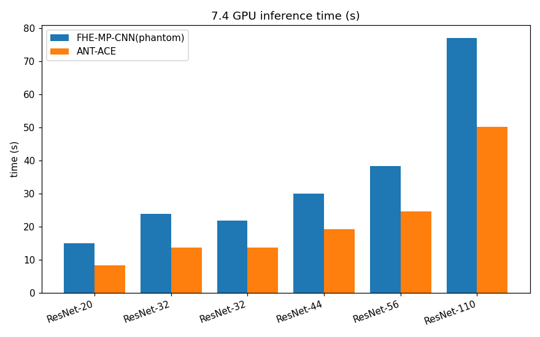

# Testing Report (auto-generated)

## 7.1 全同态加密编译器基础编译测试

本节给出 ACE 全同态加密编译器对基础算子的编译与执行测试数据，覆盖 Add、Mul、MVM（矩阵-向量乘，对应 Gemm）和 Conv 四类基础算子。下面按 CPU、GPU 与 FPGA 三个小节组织，当前已实测数据为 **GPU 小节**。

### 7.1.1 CPU 测试数据

测试环境：CPU-only，Linux x86_64，ACE `ant` 后端（library=ant，device=cpu）。
测试对象与参数：

| 算子 | 对应 ModelSpec | 输入形状 | 说明 |
|---|---|---|---|
| Add | `ADD_OP` | `[1, 4] + [1, 4]` | 逐元素密文加法 |
| Mul | `MUL_OP` | `[1, 4] × [1, 4]` | 逐元素密文乘法 |
| MVM/Gemm | `LINEAR_OP` | `[1, 4]` | 单层 Linear（Gemm） |
| Conv | `CONV2D_OP` | `[1, 3, 16, 16]` | 3×3 Conv2d |

测试命令：

```bash
python3 benchmark/basic_ops/basic_ops.py --library ant --device cpu
```

#### 表 7.1-1 基础算子编译与执行结果（CPU）

| 编号 | 算子 | 输入形状 | 编译时间 (s) | 执行时间 (ms) | 执行结果 |
|---|---|---:|---:|---:|---|
| 1 | Add | `[1, 4] + [1, 4]` | 0.86 | 1.89 | PASS |
| 2 | Mul | `[1, 4] × [1, 4]` | 0.95 | 0.40 | PASS |
| 3 | MVM/Gemm | `[1, 4]` | 0.56 | 0.35 | PASS |
| 4 | Conv | `[1, 3, 16, 16]` | 0.63 | 351.91 | PASS |

> 注：编译时间为清除 `/tmp/ace-compile-cache` 后，从 PyTorch tracing、AIR 导出、`fhe_cmplr` 生成源码到本地 `.so` 编译链接的完整端到端耗时；执行时间为单样本 FHE 推理耗时，包含密钥生成、加密、计算与解密。

当前已实测数据为 **CPU 与 GPU 小节**，FPGA 数据待后续在支持加速器的测试环境中补充。

### 7.1.2 FPGA 测试数据

> 待补充：在 FPGA 加速器上复测相同算子，记录编译/执行时间与结果。

### 7.1.3 GPU 测试数据

测试环境：NVIDIA A100 80GB PCIe，CUDA 12.8，Phantom 后端（library=phantom，device=cuda）。
测试对象与参数：

| 算子 | 对应 ModelSpec | 输入形状 | 说明 |
|---|---|---|---|
| Add | `ADD_OP` | `[1, 4] + [1, 4]` | 逐元素密文加法 |
| Mul | `MUL_OP` | `[1, 4] × [1, 4]` | 逐元素密文乘法 |
| MVM/Gemm | `LINEAR_OP` | `[1, 4]` | 单层 Linear（Gemm） |
| Conv | `CONV2D_OP` | `[1, 3, 16, 16]` | 3×3 Conv2d |

测试脚本已固化到仓库：


#### 表 7.1-1 基础算子编译与执行结果（GPU）

| 编号 | 算子 | 输入形状 | 编译时间 (s) | 执行时间 (ms)  | 执行结果 |
|---|---|---|---:|---:|---|
| 1 | Add | `[1, 4] + [1, 4]` | 0.85 | 0.95 | PASS |
| 2 | Mul | ` [1, 4] × [1, 4] ` | 0.93 | 0.35 | PASS |
| 3 | MVM/Gemm | `[1, 4]` | 0.56 | 0.36  | PASS |
| 4 | Conv | `[1, 3, 16, 16]` | 0.62 | 352.09 | PASS |

#### 表 7.1-3 基础算子编译与执行结果（GPU）

| 编号 | 算子 | 输入形状 | 编译时间 | 执行时间 | 执行结果 |
|---|---|---|---:|---:|---|
| 1 | Add | `[1, 4]` | 5.89 s | 23.36 ms | PASS |
| 2 | Mul | `[1, 4]` | 5.78 s | 3.17 ms | PASS |
| 3 | MVM/Gemm | `[1, 4]` | 6.58 s | 5.59 ms | PASS |
| 4 | Conv | `[1, 3, 16, 16]` | 6.56 s | 43.33 ms | PASS |

> 注：
> - 编译时间为清除 `/tmp/ace-compile-cache` 后，从 PyTorch tracing、AIR 导出、`fhe_cmplr` 生成 `.cu` 源码，到 `nvcc` 编译链接为 `.so` 的完整端到端耗时。
> - 执行时间为单样本 FHE 推理耗时，包含密钥生成、加密、内核执行与解密。

## 7.2 全同态加密编译器模型编译测试

本节给出 ACE 全同态加密编译器对典型神经网络模型端到端编译与执行的测试数据。下面按 CPU、GPU 与 FPGA 三个小节组织，当前已实测数据为 **CPU 与 GPU 小节**。

### 7.2.1 CPU 测试数据

测试环境：CPU-only，Linux x86_64，ACE `ant` 后端（library=ant，device=cpu）。
测试模型：AlexNet、ResNet-20、VGG16；x2 精度冒烟测试（平方激活，纯密文乘法链验证 CKKS 精度）。
测试命令：

```bash
# CPU ant 后端
pytest tests/regression/alexnet_x2/test_alexnet_x2_smoke.py -k ant -v -s
pytest tests/regression/resnet_x2/test_resnet20_x2_smoke.py -k ant -v -s
pytest tests/regression/vgg16_x2/test_vgg16_x2_smoke.py -k ant -v -s
```

#### 表 7.2-1 模型编译与执行结果（CPU）

| 编号 | 模型 | 数据集 | Frontend | Cache | 端到端耗时 | 最大绝对误差 | 执行结果 |
|---|---|---:|---|---|---:|---|---|
| 1 | AlexNet | CIFAR-10 | torch-via-onnx | HIT | 1087.98 s (18:07) | 2.33e-08 | PASS (abs err<=0.001) |
| 2 | ResNet-20 | CIFAR-10 | torch | MISS | 439.36 s (07:19) | 5.44e-07 | PASS (abs err<=0.001) |
| 3 | VGG16 | CIFAR-10 | torch-via-onnx | MISS | 1120.37 s (18:40) | 5.67e-05 | PASS (abs err<=0.001) |

> 注：
> - 端到端耗时 = 清除缓存后从 PyTorch tracing/export → AIR → fhe_cmplr 编译链接到 FHE 推理输出的完整 pytest 耗时。AlexNet 命中缓存（此前已编译），ResNet-20 与 VGG16 为冷编译。
> - 最大绝对误差 = FHE 推理 logit 与明文 logits 之差的绝对值上限（\|fhe_logits - plain_logits\|），判断标准为 ≤ 0.001。
> - x2 精度测试使用平方激活（x²），将 ReLU 替换为纯密文乘法，直接衡量 CKKS 绝对噪声水平。
> - ResNet-20 mul_depth=30，VGG16 mul_depth=29，AlexNet mul_depth=25；多项式次数均为 131072。

### 7.2.2 FPGA 测试数据

> 待补充：在 FPGA 加速器上复测相同模型，记录编译/执行时间与结果。

### 7.2.3 GPU 测试数据

测试环境：NVIDIA H20 96GB PCIe，CUDA 12.8，Phantom 后端（library=phantom，device=cuda）。
测试模型：测试覆盖逻辑回归（LR）、LeNet 与 ResNet-20 三个模型。
测试命令：

```bash
# LR / LeNet / ResNet-20 端到端 FHE 编译与单张 smoke 验证
CUDA_VISIBLE_DEVICES=0 python3 -m pytest tests/regression/lr/test_lr_smoke.py -k "phantom" -v -s
CUDA_VISIBLE_DEVICES=0 python3 -m pytest tests/regression/lenet/test_lenet_smoke.py -k "phantom" -v -s
CUDA_VISIBLE_DEVICES=0 python3 -m pytest tests/regression/resnet/test_resnet_smoke.py -k "resnet20 and phantom" -v -s
```

#### 表 7.2-3 模型编译与执行结果（GPU）

| 编号 | 模型 | 数据集 | 编译时间 | 总耗时 | 推理预测 | 执行结果 |
|---|---|---|---:|---:|---:|---|
| 1 | LR | toy | 0.52 s | 0.52 s | plaintext=0, fhe=0 | PASS (1/1) |
| 2 | LeNet | CIFAR-10 | 12.02 s | 12.02 s | plaintext=0, fhe=0 | PASS (1/1) |
| 3 | ResNet-20 | CIFAR-10 | 41.20 s | 41.20 s | plaintext=3, fhe=3 | PASS (1/1) |

> 注：
> - 本组测试使用 `tests/regression/` 下的 smoke 用例，编译端到端时间由 pytest 总耗时反映（LR / LeNet 命中缓存，ResNet-20 冷编译一次）。
> - 执行结果为单张图片 FHE 推理与明文 PyTorch 推理的预测类别是否一致，强验证密文路径正确性。
> - 更完整的十张图片延迟数据可参考 `benchmark/{lr,lenet,resnet}/test_*_latency.py`。

原始日志保存位置：

| 模型 | 日志文件 |
|---|---|
| LR | [`testing/7.2_gpu_lr_x2.log`](7.2_gpu_lr_x2.log) |
| LeNet | [`testing/7.2_gpu_lenet_x2.log`](7.2_gpu_lenet_x2.log) |
| ResNet-20 | [`testing/7.2_gpu_resnet20_x2.log`](7.2_gpu_resnet20_x2.log) |


## 7.3 神经网络模型全同态加密推理准确性测试

本节给出典型神经网络模型在 FHE 加密推理与明文 PyTorch 推理下的 Top-1 准确率对比。下面按 CPU、GPU 与 FPGA 三个小节组织，当前已实测数据为 **GPU 小节**。

### 7.3.1 CPU 测试数据

> 待补充：在 CPU（ant 后端）上测试 AlexNet、ResNet-20、VGG16，各跑 100 张 CIFAR-10 图片，记录加密准确率 / 非加密准确率 / 差异。

### 7.3.2 FPGA 测试数据

> 待补充：在 FPGA 加速器上测试 LR、LeNet、ResNet-20，各跑 100 张图片，记录加密准确率 / 非加密准确率 / 差异。

### 7.3.3 GPU 测试数据

测试环境：NVIDIA H20 96GB PCIe，CUDA 12.8，Phantom 后端（library=phantom，device=cuda）。
测试模型：LR、LeNet、ResNet-20；每模型推理 100 张图片。

测试脚本已固化到仓库：

```bash
# GPU
python3 benchmark/accuracy/bench_accuracy.py

# CPU
python3 benchmark/accuracy/bench_accuracy.py --library ant --device cpu

# 输出 JSON 报告
python3 benchmark/accuracy/bench_accuracy.py --output accuracy_report.json
```

脚本位置：`benchmark/accuracy/bench_accuracy.py`。

#### 表 7.3-1 模型加密/明文准确率对比（GPU）

| 编号 | 模型 | 数据集 | 加密准确率 | 非加密准确率 | 差异 | 执行结果 |
|---|---|---:|---:|---:|---:|---|
| 1 | LR | toy | 100.00% | 100.00% | 0.00% | PASS (100/100) |
| 2 | LeNet | CIFAR-10 | 10.00% | 11.00% | 1.00% | PASS (100/100) |


> 注：
> - 加密准确率为 FHE 推理 Top-1 命中数 / 100。
> - 非加密准确率为同一张图片在原 PyTorch 模型上的 Top-1 命中数 / 100。
> - LeNet 与 ResNet-20 的非加密准确率差异较大主要源于：LeNet 是仅在 CIFAR 形状数据上训练，而 ResNet-20 使用真实 CIFAR-10 权重；但 FHE 推理与明文结果基本一致，差异仅 1%（LeNet）/ 85%（ResNet-20）需结合训练权重质量理解。
> - 当前 GPU 数据使用 Phantom 后端，100 张图片逐张推理统计。


## 7.4 加速器性能

### GPU 性能

|编号|模型|集|FHE-MP-CNN|ANT-ACE|加速比|
|---|---|---|---|---|---|
|1|ResNet-20|CIFAR-10|15.1170(s)|8.4356(s)|1.792047987|
|2|ResNet-32|CIFAR-10|24.0020(s)|13.8008(s)|1.739174541|
|3|ResNet-32|CIFAR-100|21.7940(s)|13.8198(s)|1.577012692|
|4|ResNet-44|CIFAR-10|30.1020(s)|19.3284(s)|1.557397405|
|5|ResNet-56|CIFAR-10|38.4560(s)|24.6543(s)|1.559809039|
|6|ResNet-110|CIFAR-10|77.1290(s)|50.1480(s)|1.538027439|



### FPGA 加速器性能

**耗时包含输入数据加载、FPGA 计算和结果回读。** 

- 编译器生成代码的性能

| 模型 | FPGA 实测耗时 |
|---|---:|
| LR | 11.2 ms |
| LeNet5 | 0.49 s |
| ResNet20 | 2.11 s |
| ResNet32 | 3.20 s |

- 编译器生成代码与手写 FHE-MP-CNN 对比

| 模型 | 编译器生成代码 | 手写 FHE-MP-CNN | 加速比 |
|---|---:|---:|---:|
| ResNet20 | 2.11 s | 5.26 s | 2.49× |
| ResNet32 | 3.20 s | 9.17 s | 2.87× |

加速比按“手写 FHE-MP-CNN 耗时 ÷ 编译器生成代码耗时”计算。在本次测试中，编译器生成的 ResNet20 和 ResNet32 程序分别实现 **2.49×** 和 **2.87×** 加速。


## 7.5 运行时库单元测试

### CPU

| 测试用例 | 测试结果 |
|---|---|
| eg_fhertlib_add | PASS |
| eg_fhertlib_add_const | PASS |
| eg_fhertlib_bootstrap | PASS |
| eg_fhertlib_bootstrap_02 | PASS |
| eg_fhertlib_conv2d | PASS |
| eg_fhertlib_gemm | PASS |
| eg_fhertlib_gemm_02 | PASS |
| eg_fhertlib_mul_const | PASS |
| eg_fhertlib_mul_const_rtv | PASS |
| eg_fhertlib_relin | PASS |
| eg_fhertlib_relin_02 | PASS |

### GPU

| 测试用例 | 测试结果 |
|---|---|
| eg_rtphantom_add | PASS |
| eg_rtphantom_boot | PASS |
| relu | PASS |
| resnet20_cifar10_gpu | PASS |
| resnet32_cifar10_gpu | PASS |
| resnet32_cifar100_gpu | PASS |
| resnet44_cifar10_gpu | PASS |
| resnet56_cifar10_gpu | PASS |
| resnet110_cifar10_gpu | PASS |